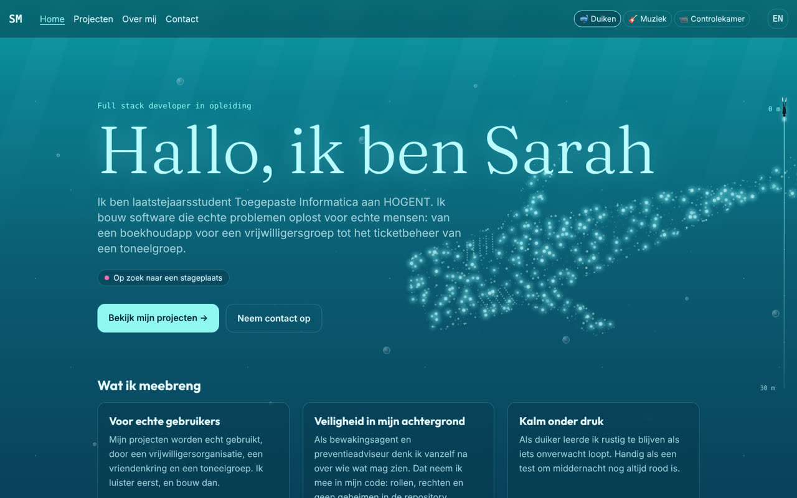
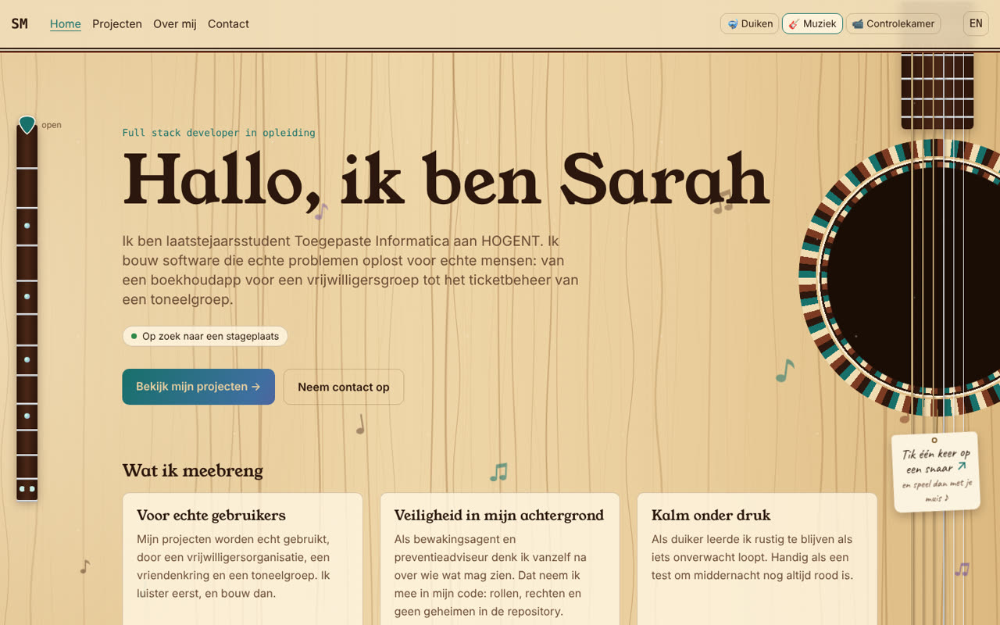
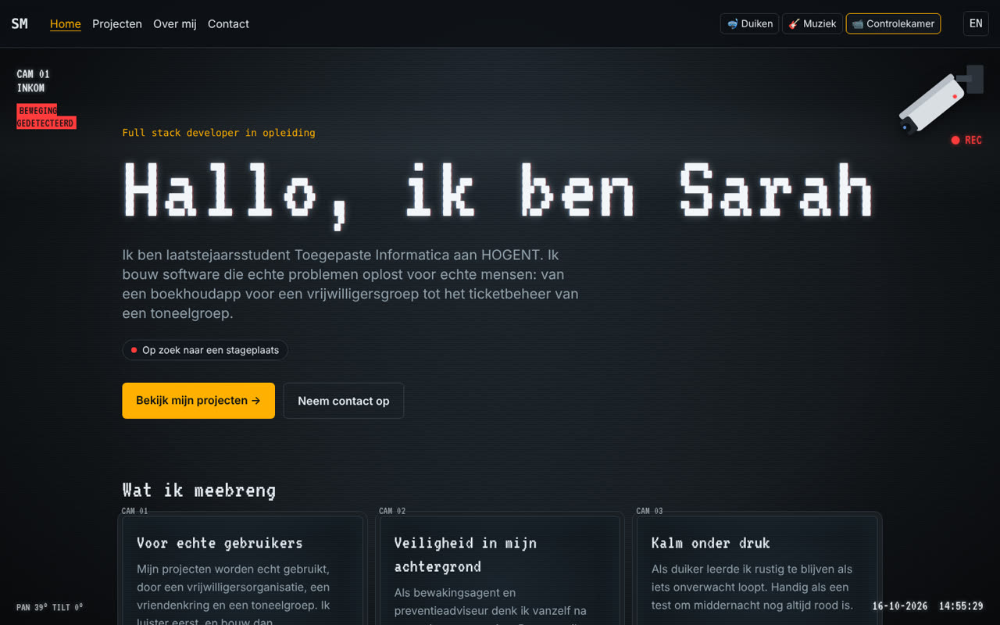

# Portfolio Sarah Mertens

Mijn persoonlijke portfolio als full stack developer in opleiding: wie ik ben, wat ik bouwde en hoe je me bereikt. In het Nederlands en het Engels, en te bekijken in drie thema's.

**Live:** [sarahmertens.netlify.app](https://sarahmertens.netlify.app)

| 🤿 Duiken | 🎸 Muziek | 📹 Controlekamer |
| --- | --- | --- |
|  |  |  |

## Wat zit erin

- **Projecten** met een eigen pagina per project: de opdracht, wat ik bouwde, technische keuzes, links naar de code en waar mogelijk een live demo of video.
- **Twee talen**: alle pagina's bestaan in het Nederlands (`/nl/`) en het Engels (`/en/`), met één klik wissel je van taal op dezelfde pagina.
- **Drie thema's**, gekozen rond mijn hobby's en mijn werk. Elke pagina is binnen een thema een andere plek:

  | Pagina | 🤿 Duiken | 🎸 Muziek | 📹 Controlekamer |
  | --- | --- | --- | --- |
  | Home | Open water met een walvishaai | Bovenblad van een akoestische gitaar | CAM 01 · Inkom |
  | Projecten | Koraalrif met een school visjes | Sunburst-gitaar | CAM 02–05 · Monitorwand |
  | Project | Zandbodem met een kwal | Klassieke gitaar met nylon snaren | CAM 06 · Opname |
  | Over mij | Scheepswrak met een zeeschildpad | Achterkant in palissander | CAM 07 · Nachtzicht |
  | Contact | De diepte met een manta en een hengelvis | De gitaarkoffer | CAM 08 · Meldkamer |

  Elk thema heeft iets dat met het scrollen meebeweegt (een dieptemeter, een plectrum op de gitaarhals, een camera die kantelt) en iets om mee te spelen: bij Muziek kan je de snaren bespelen (de klank wordt in de browser berekend met het Karplus-Strong-algoritme), bij Controlekamer volgt een bewakingscamera je muis.
- **Contactformulier** via Netlify Forms, met een verborgen veld tegen spam.

## Toegankelijk en snel

- Statische site: elke pagina is gewone HTML, er draait geen server.
- Lettertypes staan op de site zelf (geen Google Fonts): sneller en beter voor de privacy.
- Alle decoratie is `aria-hidden` en ligt achter de inhoud; de inhoud blijft gewone, leesbare HTML.
- Wie in zijn systeem "minder beweging" vraagt (`prefers-reduced-motion`), krijgt stilstaande thema's.
- Volledig te bedienen met het toetsenbord, met een "naar de inhoud"-link en zichtbare focus.
- Geluid enkel na een klik van de bezoeker, nooit vanzelf.

## Gebouwd met

- [Astro](https://astro.build) (statische site, content collections voor de projecten)
- TypeScript (strict)
- [Tailwind CSS 4](https://tailwindcss.com) met eigen design tokens per thema
- Netlify (hosting, automatisch online bij elke push, Netlify Forms)
- De tekeningen in de thema's (walvishaai, zeebodems, gitaarkoffer …) zijn met eigen Python-scripts gegenereerd als SVG.

## Zelf draaien

Je hebt [Node.js](https://nodejs.org) (versie 22 of nieuwer) en [pnpm](https://pnpm.io) nodig.

```bash
pnpm install       # pakketten installeren
pnpm dev           # ontwikkelserver op http://localhost:4321
pnpm build         # de site bouwen in dist/
pnpm preview       # de gebouwde site bekijken
pnpm astro check   # TypeScript- en Astro-controle
```

## Structuur

```
src/
├── content/projects/      # één Markdown-bestand per project, per taal (nl/ en en/)
├── content.config.ts      # het schema: welke velden een project moet hebben
├── data/                  # gegevens die op meerdere plaatsen terugkomen (contact, over mij)
├── i18n/ui.ts             # alle vaste teksten van de site, in het Nederlands en het Engels
├── themes.ts              # de lijst met thema's (de themaknoppen komen hier vandaan)
├── components/
│   ├── themes/            # de decoratie per thema, en scenes.ts (welke pagina welke plek is)
│   └── ...                # header, footer, projectkaart, tijdlijn ...
├── layouts/BaseLayout.astro
├── pages/[lang]/          # elke pagina één keer, voor beide talen
└── styles/
    ├── global.css         # basisstijl en design tokens
    └── themes/            # één CSS-bestand per thema
public/
├── themes/                # tekeningen per thema
└── videos/                # projectvideo's
```

## Een project toevoegen

Maak twee bestanden met dezelfde naam: `src/content/projects/nl/mijn-project.md` en `src/content/projects/en/mijn-project.md`. Bovenaan staan de gegevens, daaronder de tekst in Markdown:

```md
---
title: Mijn project
summary: Eén zin over wat het is (max. 160 tekens).
order: 8                  # volgorde op de projectenpagina
year: 2026
context: personal         # school | personal | volunteer | internship
role: Volledig zelf ontwikkeld
tech: [Astro, TypeScript]
github: https://github.com/SarahMertens/mijn-project
demo: https://...         # optioneel
featured: false           # true = op de homepagina
---

## De opdracht
...
```

Astro controleert de gegevens met het schema in `src/content.config.ts`. Ontbreekt er iets, dan stopt de build met een duidelijke foutmelding.

## Een thema toevoegen

1. Voeg een regel toe in `src/themes.ts` (id, icoontje en naam in beide talen).
2. Maak `src/styles/themes/<id>.css` en importeer het in `global.css`. Overschrijf daarin de kleurvariabelen op `:root[data-theme='<id>']`.
3. Maak eventueel een decoratie-onderdeel in `src/components/themes/` en zet het in `BaseLayout.astro`.
4. Voeg `public/favicon-<id>.svg` toe voor het icoontje in het tabblad.

De themaknop, het onthouden van de keuze en het wisselen zonder flits werken dan vanzelf.

## Hoe dit gemaakt is

Ik heb deze site zelf opgebouwd en elke stap getypt en getest. Daarbij gebruikte ik Claude (AI van Anthropic) als begeleider: om mee te denken over de opbouw en voorbeelden te geven, onder meer voor de tekeningen en de animaties in de thema's.

## Contact

Ik zoek een stageplaats als full stack developer.
Mail me op [sarah.mertens.2005@gmail.com](mailto:sarah.mertens.2005@gmail.com) of gebruik het [contactformulier](https://sarahmertens.netlify.app/nl/contact/).

---

© 2026 Sarah Mertens. De code mag je bekijken en ervan leren; de teksten, tekeningen en video's zijn van mij.
